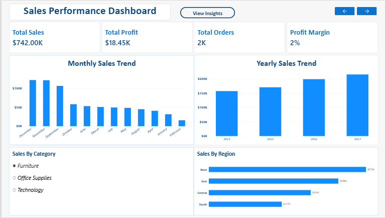
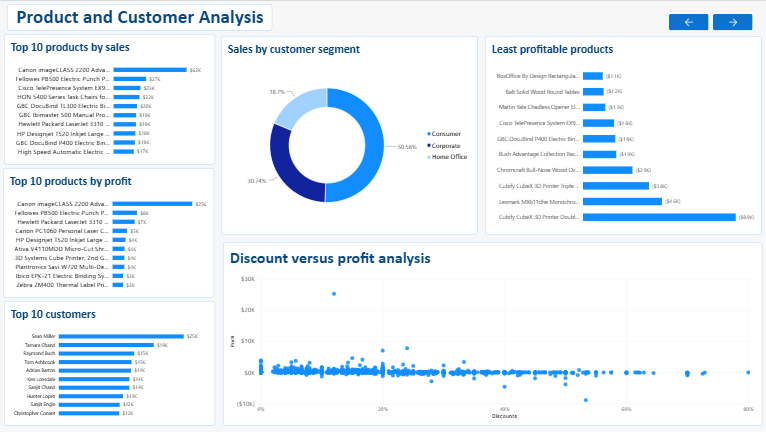

# Sales Performance Analysis

## Project Overview
An end-to-end retail sales analysis project using SQL, Python (Pandas), and Power BI.

The purpose of this project is to analyze sales performance, identify business trends, evaluate product profitability, and provide actionable business recommendations.

## Tools & Technologies
- Python
- Pandas
- Matplotlib
- Seaborn
- SQL (PostgreSQL)
- Power BI
- DAX

## Project Objectives
- Clean and prepare retail sales data.
- Calculate important business KPIs.
- Analyze monthly sales trends.
- Evaluate product and regional performance.
- Identify profitable and unprofitable products.
- Build an interactive Power BI dashboard.

## Project Workflow
1. Data collection
2. Data cleaning using Pandas
3. Exploratory data analysis
4. SQL business analysis
5. KPI calculations
6. Power BI dashboard development
7. Business insights and recommendations

## Key Performance Indicators
- Total Sales
- Total Profit
- Total Orders
- Total Customers
- Average Order Value
- Profit Margin

## Key Findings
- Seasonality & Growth: Sales show a strong overall upward trajectory since 2014, with consistent revenue spikes during September, November, and December.

- Peak Performance:
   - Highest Revenue Month: November 2017 ($118,447.83)
   - Highest Profit Month: December 2016 ($17,885.31)

- Profitability & Order Metrics: The overall store profit margin sits at 2.0%, with an Average Order Value (AOV) of $458.61.

- Discount Risks: Heavy discounting directly undermines financial health; discounts of 30% or higher consistently turn profitable transactions into net losses.

- Category Performance: The Technology category leads the business in both total sales and overall profit.

- Product Dynamics: While high-revenue items like the Canon imageCLASS 2200 Advanced Copier drive large transactions, high-volume everyday items like Stapes drive steady product movement.

- Market Leaders: The West region and the Consumer segment drive the majority of the business volume.

## Business Recommendations
- Implement a maximum discount cap (e.g., limit standard discounts to 15%–20%) across all product categories. Instead of deep price-cutting to drive volume, focus sales strategies on value-add promotions (like bundle deals or free shipping thresholds) to protect profit margins.
- Conduct a cost-to-serve analysis on these specific loss-making items. Renegotiate supplier costs, adjust list prices, or restructure shipping fees for bulky items so that high sales volume actually translates into net profit.
- Align inventory procurement and marketing budgets ahead of these peak months. Ensure stock levels for top-selling items are fully optimized by late Q3 to prevent stockouts, and ramp up targeted digital ad campaigns ahead of the November holiday shopping rush.
- Allocate targeted marketing spend and customer retention programs toward the Consumer segment and Western geographic markets where brand presence is already strong. Simultaneously, investigate why regions like the South or Corporate/Home Office segments lag behind, and design tailored campaigns to boost engagement there.

## Dashboard Preview

## Project Files
- sql/
- powerbi/
- images/
- Notebook/
- PowerBI/
- SQL/

## Author
Data Analyst Portfolio Project BY Fatima Abdullah
